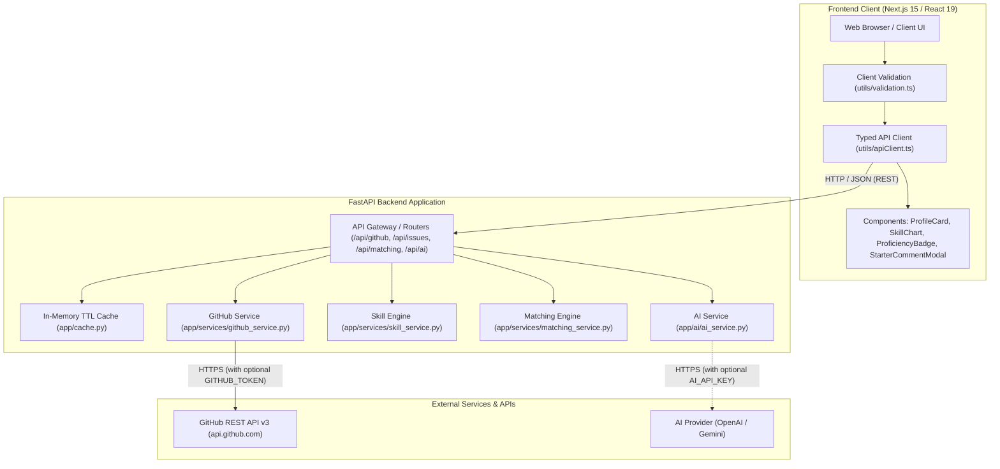
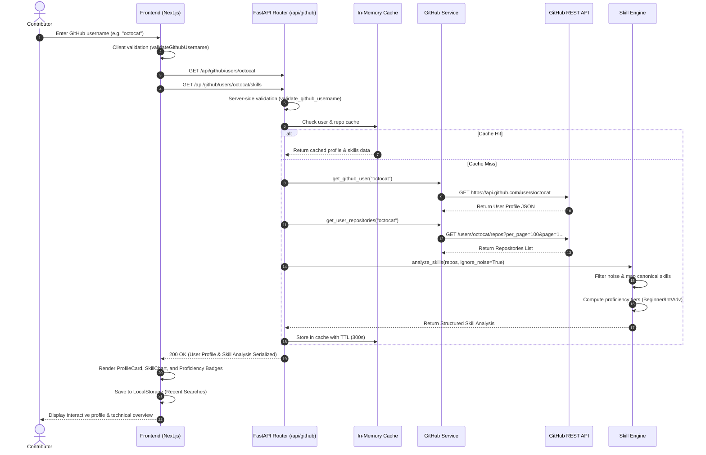
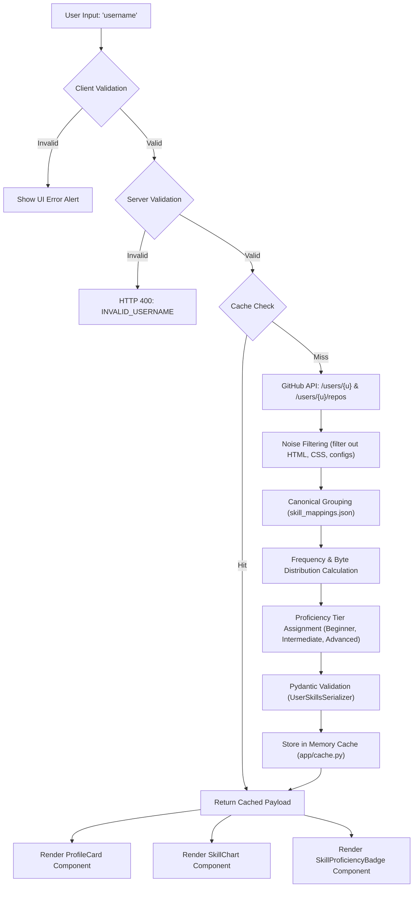
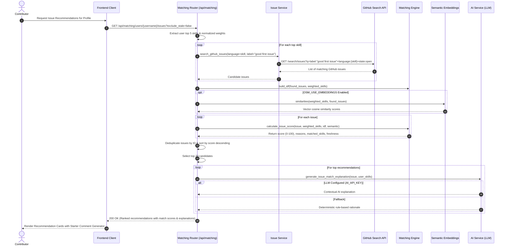
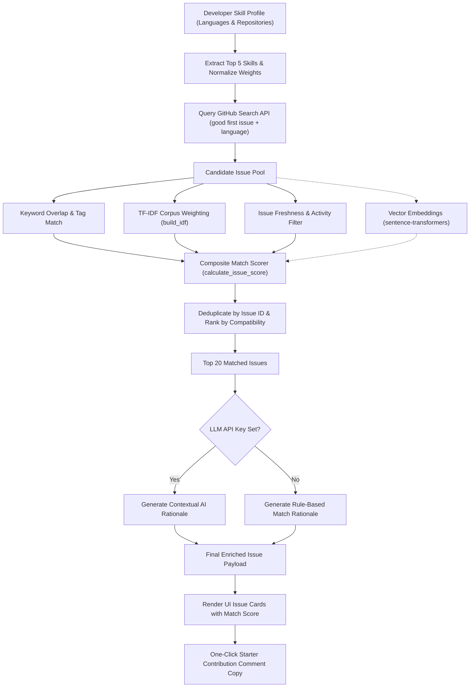

# OpenSourceMate Architecture

This document describes the software architecture, design principles, system components, and data-flow pipelines of **OpenSourceMate**. It is intended to help contributors and maintainers understand how requests flow through the system and how components interact.

---

## Table of Contents

1. [High-Level System Architecture](#1-high-level-system-architecture)
2. [Folder & Directory Structure](#2-folder--directory-structure)
3. [Request Flow 1: Profile & Skill Analysis](#3-request-flow-1-profile--skill-analysis)
   - [Pipeline Description](#pipeline-description)
   - [Sequence Diagram](#sequence-diagram)
   - [Data Transformation Flowchart](#data-transformation-flowchart)
4. [Request Flow 2: Contribution Discovery & Issue Matching](#4-request-flow-2-contribution-discovery--issue-matching)
   - [Matching Algorithm Description](#matching-algorithm-description)
   - [Sequence Diagram](#matching-sequence-diagram)
   - [Matching Engine Pipeline Flowchart](#matching-engine-pipeline-flowchart)
5. [Backend Subsystems](#5-backend-subsystems)
   - [API Routers & Endpoints](#api-routers--endpoints)
   - [Services Layer](#services-layer)
   - [In-Memory TTL Caching](#in-memory-ttl-caching)
   - [Unified Error Handling](#unified-error-handling)
   - [Configuration & Production Invariants](#configuration--production-invariants)
6. [Frontend Subsystems](#6-frontend-subsystems)
   - [App Router Architecture](#app-router-architecture)
   - [Components & UI State](#components--ui-state)
   - [API Client & Validation](#api-client--validation)
7. [AI & Semantic Embeddings Layer](#7-ai--semantic-embeddings-layer)
8. [Testing & Quality Assurance](#8-testing--quality-assurance)

---

## 1. High-Level System Architecture

OpenSourceMate follows a decoupled **Client-Server Architecture** composed of:

* **Next.js Frontend (App Router, React 19, TypeScript, Tailwind CSS)**: Provides an accessible, responsive single-page user interface for username input, profile exploration, visual skill charts, proficiency tiers, and contribution recommendation cards.
* **FastAPI Backend (Python 3.10+, Uvicorn, Pydantic)**: Exposes performant asynchronous REST endpoints, enforces input validation, queries GitHub REST APIs with automatic pagination and TTL caching, runs skill extraction and grouping heuristics, and executes semantic issue matching with optional LLM explanations.
* **External Integrations**:
  * **GitHub REST API v3**: Source for public user metadata, public repositories, and issue search.
  * **Sentence Transformers / Embeddings**: Offline or local semantic similarity computation for developer skills against issue titles/bodies.
  * **OpenAI / Google GenAI**: Optional LLM-assisted generation of contextual contributor match reasons.



---

## 2. Folder & Directory Structure

```text
OpenSourceMate/
├── .github/                       # GitHub actions workflows, issue and PR templates
│   ├── ISSUE_TEMPLATE/            # Templates for bug reports and feature requests
│   ├── workflows/ci.yml           # Automated CI running backend tests and frontend linter/build
│   └── PULL_REQUEST_TEMPLATE.md   # Standard pull request description guidelines
│
├── backend/                       # FastAPI backend microservice
│   ├── app/
│   │   ├── ai/                    # AI integration modules
│   │   │   └── ai_service.py      # OpenAI / LLM integration and fallback explanations
│   │   ├── api/                   # REST API routes and endpoints
│   │   │   └── routes/
│   │   │       ├── ai.py          # /api/ai endpoints (issue analysis)
│   │   │       ├── github.py      # /api/github endpoints (profile, repos, skills)
│   │   │       ├── issues.py      # /api/issues endpoints (issue search)
│   │   │       └── matching.py    # /api/matching endpoints (contributor recommendations)
│   │   ├── data/
│   │   │   └── skill_mappings.json# Canonical skill mapping and noise filtering rules
│   │   ├── schemas/               # Request/response schemas and serializers
│   │   │   └── serializers.py     # Pydantic data models for typed serialization
│   │   ├── services/              # Core business logic and computational services
│   │   │   ├── embedding_service.py # Vector embeddings and cosine similarity
│   │   │   ├── github_service.py  # Asynchronous HTTP client for GitHub REST API
│   │   │   ├── issue_service.py   # GitHub issue discovery and filtering
│   │   │   ├── matching_service.py# TF-IDF, scoring heuristics, and ranking
│   │   │   └── skill_service.py   # Language aggregation, noise filter, proficiency calculation
│   │   ├── utils/
│   │   │   └── validation.py      # Server-side validation rules (e.g., GitHub usernames)
│   │   ├── cache.py               # In-memory TTL cache with thread-safe expiration
│   │   ├── config.py              # Environment settings, secrets validation, production assertions
│   │   ├── exceptions.py          # Custom domain exceptions (e.g. GitHubRateLimitError)
│   │   └── main.py                # FastAPI entry point, middleware stack, error handlers
│   ├── evaluation/                # Offline evaluation harness for matching algorithms
│   │   ├── build_dataset.py       # Script to harvest labeled issue-contributor datasets
│   │   ├── evaluate.py            # Precision/Recall/NDCG evaluation metrics runner
│   │   └── labelled_issues.json   # Benchmark golden dataset
│   ├── tests/                     # Pytest suite with mock GitHub responses
│   ├── pytest.ini                 # Pytest configuration
│   ├── requirements.txt           # Production dependencies
│   ├── requirements-dev.txt       # Development and testing dependencies
│   └── requirements-optional.txt  # Optional ML dependencies (sentence-transformers)
│
├── frontend/                      # Next.js 15 frontend application
│   ├── __tests__/                 # Jest and React Testing Library test specs
│   ├── app/                       # Next.js App Router root
│   │   ├── error.tsx              # Error boundary component
│   │   ├── layout.tsx             # Root HTML layout with providers and metadata
│   │   ├── not-found.tsx          # 404 page
│   │   └── page.tsx               # Main single-page application dashboard
│   ├── components/                # Modular React UI components
│   │   ├── ExportMenu.tsx         # JSON/Markdown analysis exporter
│   │   ├── FAQ.tsx                # Frequently asked questions collapsible panel
│   │   ├── GitHubLink.tsx         # External link widget with safety attributes
│   │   ├── ProfileCard.tsx        # Contributor profile details and stats display
│   │   ├── RecentSearches.tsx     # Recent search history badges with local persistence
│   │   ├── SavedIssuesModal.tsx   # Saved/bookmarked issues drawer
│   │   ├── SkillChart.tsx         # Responsive skill distribution visualization
│   │   ├── SkillProficiencyBadge.tsx # Beginner, Intermediate, Advanced indicator
│   │   └── StarterCommentModal.tsx# One-click starter issue claim comment generator
│   ├── hooks/                     # Custom React hooks (e.g., useBookmarkedIssues)
│   ├── types/                     # TypeScript interface definitions (api.ts)
│   └── utils/                     # Frontend client utilities
│       ├── apiClient.ts           # Fetch client with base URL resolution and error handling
│       ├── exportAnalysis.ts      # Markdown/JSON export formatting logic
│       ├── proficiency.ts         # Visual badges and tier mapping
│       ├── recentSearches.ts      # LocalStorage manager for search history
│       └── validation.ts          # Username format validation regex
│
├── docs/                          # Architectural specs, audits, and contributor guides
├── CONTRIBUTING.md                # Contributor setup, PR process, and code standards
├── LICENSE                        # MIT License
└── README.md                      # Project documentation and quick start guide
```

---

## 3. Request Flow 1: Profile & Skill Analysis

### Pipeline Description

1. **User Input & Validation**:
   * The user enters a GitHub username into the search bar on `frontend/app/page.tsx`.
   * `frontend/utils/validation.ts` performs client-side pre-validation against GitHub username rules (`1-39` characters, alphanumeric or single hyphens, no leading/trailing hyphen).
   * If valid, the frontend initiates parallel requests to `/api/github/users/{username}` and `/api/github/users/{username}/skills` via `frontend/utils/apiClient.ts`.
2. **Backend Validation & Gateway**:
   * The FastAPI route validates the username again on the server side using `backend/app/utils/validation.py`.
   * Invalid usernames trigger an HTTP 400 response with error code `INVALID_USERNAME`.
3. **Cache Lookup**:
   * `backend/app/cache.py` checks for cached responses using the key format `user:{username}` and `repos:{username}`.
   * If fresh (within TTL, default 300 seconds), cached results are returned immediately, bypassing GitHub API rate limits.
4. **GitHub API Ingestion & Pagination**:
   * When a cache miss occurs, `backend/app/services/github_service.py` fetches the user's public profile from GitHub REST API v3 (`GET /users/{username}`).
   * Next, it queries `GET /users/{username}/repos` with automatic pagination (`per_page=100`, configurable cap up to 300 repositories) to collect the complete catalog of non-fork or all public repositories.
   * For deeper language byte counts, repository details are fetched asynchronously.
5. **Skill Analysis & Noise Filtering Engine**:
   * `backend/app/services/skill_service.py` inspects the repository catalog:
     * **Language Counting**: Aggregates language occurrences and byte counts.
     * **Noise Filtering**: Eliminates boilerplate configuration formats (e.g., `HTML`, `CSS`, `TeX`, `Dockerfile`) if `ignore_noise=True`.
     * **Skill Grouping**: Maps synonyms and frameworks to canonical technologies using `backend/app/data/skill_mappings.json` (e.g., `TypeScript` + `React` → Web Ecosystem).
     * **Proficiency Tier Calculation**: Categorizes skills into `Beginner`, `Intermediate`, or `Advanced` based on repository usage percentage and count.
6. **Serialization & Response**:
   * Results are validated against Pydantic serializers (`ExtendedGitHubUserProfileSerializer`, `UserSkillsSerializer`).
   * The response is cached in memory and sent to the client.
7. **UI Rendering**:
   * Frontend updates `ProfileCard.tsx` with user statistics.
   * Renders `SkillChart.tsx` with proportional progress bars.
   * Renders `SkillProficiencyBadge.tsx` highlighting top tiers.
   * Appends the query to `recentSearches` in `localStorage`.

### Sequence Diagram



### Data Transformation Flowchart



---

## 4. Request Flow 2: Contribution Discovery & Issue Matching

### Matching Algorithm Description

The planned and evolving contribution discovery pipeline connects developer skill profiles to curated open GitHub issues:

1. **Top Skill Extraction**:
   * The top 5 skills from the analyzed profile are identified with normalized weights:
     $$\text{weight}_i = \frac{\text{repo\_count}_i}{\max(\text{repo\_counts})}$$
2. **Issue Ingestion**:
   * `backend/app/services/issue_service.py` searches GitHub for open issues tagged `good first issue` or `help wanted` filtered by the user's primary languages.
3. **Multi-Factor Compatibility Scoring**:
   * `backend/app/services/matching_service.py` evaluates candidate issues using a weighted composite formula:
     * **Direct Skill Overlap**: Matches between issue title, description, and repository primary language against user skills.
     * **TF-IDF Term Weighting**: Rare technologies carry higher discriminative signal than common terms (`build_idf`).
     * **Freshness & Activity**: Boosts recently created or updated issues; flags issues with no activity for >60 days (`freshness`).
     * **Semantic Similarity**: When enabled (`OSM_USE_EMBEDDINGS=True`), embeddings from `backend/app/services/embedding_service.py` score semantic closeness between issue topics and user technologies.
4. **AI-Powered Explanations**:
   * `backend/app/ai/ai_service.py` analyzes the top matches. If an AI provider key is configured, it calls the LLM to generate a concise, encouraging sentence explaining *why* this issue matches the developer's experience. If unconfigured, a deterministic rule-based explanation is generated.
5. **Starter Comment Generator**:
   * Each issue card provides a one-click starter comment generator (`frontend/components/StarterCommentModal.tsx`) allowing contributors to copy a polite, maintainer-friendly issue assignment claim customized to their matched language.

### Matching Sequence Diagram



### Matching Engine Pipeline Flowchart



---

## 5. Backend Subsystems

### API Routers & Endpoints

| Method | Endpoint | Description |
|---|---|---|
| `GET` | `/api/health` | Health check returning service status and version (`HealthResponseSerializer`) |
| `GET` | `/api/health/diagnostics` | GitHub API rate limit status and in-memory cache diagnostics |
| `GET` | `/api/github/users/{username}` | Public profile info (`ExtendedGitHubUserProfileSerializer`) |
| `GET` | `/api/github/users/{username}/repositories` | Paginated public repositories (`RepositoryListSerializer`) |
| `GET` | `/api/github/users/{username}/skills` | Analyzed skills, distribution, and proficiency tiers (`UserSkillsSerializer`) |
| `GET` | `/api/issues/search` | Search good first issues by language, label, keyword |
| `GET` | `/api/matching/users/{username}/issues` | Matched and ranked recommendations with scores and explanations |
| `POST` | `/api/matching/explain` | On-demand match explanation for an issue + skill set |
| `POST` | `/api/ai/analyze-issue` | AI-assisted issue analysis (`IssueAnalysisRequestSerializer`) |

### Services Layer

The backend uses a clean **Service Layer Pattern**:

* `github_service.py`: Encapsulates asynchronous HTTP calls via `httpx.AsyncClient`. Implements exponential backoff, rate limit header detection, repository pagination, and error wrapping (`GitHubRateLimitError`).
* `skill_service.py`: Pure computational logic for parsing repository metadata, filtering configuration files, canonicalizing technologies, and categorizing developer proficiency into tiers.
* `issue_service.py`: Handles GitHub Issue Search queries with parameter sanitization and result normalization.
* `matching_service.py`: Computes IDF weights, keyword intersections, issue freshness penalties, and composite ranking scores.
* `embedding_service.py`: Provides vector embeddings when optional ML libraries are installed.

### In-Memory TTL Caching

* Implemented in `backend/app/cache.py` via `TTLCache`.
* Caches raw GitHub responses for 300 seconds (configurable via `GITHUB_CACHE_TTL`).
* Tracks cache metrics: `hits`, `misses`, `evictions`, and current size.
* Can be inspected at runtime via `GET /api/health/diagnostics`.

### Unified Error Handling

All backend exceptions are caught by centralized FastAPI exception handlers in `backend/app/main.py` and returned in a consistent schema:

```json
{
  "error": {
    "code": "INVALID_USERNAME",
    "message": "Invalid GitHub username '-octocat'.",
    "details": { "username": "-octocat" }
  },
  "detail": "Invalid GitHub username '-octocat'."
}
```

Standardized error codes include:
* `INVALID_USERNAME` (400)
* `NOT_FOUND` (404)
* `VALIDATION_ERROR` (422)
* `RATE_LIMIT_EXCEEDED` (429)
* `INTERNAL_SERVER_ERROR` (500)

### Configuration & Production Invariants

Defined in `backend/app/config.py` using Pydantic `BaseSettings`:
* **Zero-Credential Local Run**: Runs out of the box with safe defaults without needing any API keys.
* **Production Invariants**: When `ENVIRONMENT=production`, the application strictly enforces:
  1. `DEBUG` must be `False`.
  2. `SECRET_KEY` must not be the default value and must be at least 16 characters.
  3. Fails loudly on startup if these invariants are violated.

---

## 6. Frontend Subsystems

### App Router Architecture

* Located under `frontend/app/`.
* `layout.tsx`: Configures viewport metadata, fonts, and dark mode theme classes.
* `page.tsx`: Single-page dashboard orchestrating user state, profile queries, skill cards, issue modals, and export utilities.
* `error.tsx` & `global-error.tsx`: React error boundaries capturing unexpected client-side runtime errors.
* `not-found.tsx`: Accessible custom 404 page.

### Components & UI State

* **ProfileCard (`components/ProfileCard.tsx`)**: Displays avatar, bio, follower metrics, public repo count, and external GitHub profile link.
* **SkillChart (`components/SkillChart.tsx`)**: Renders visual bar charts of detected languages with percentages and repository counts.
* **SkillProficiencyBadge (`components/SkillProficiencyBadge.tsx`)**: Visually indicates competency tier (`Beginner`, `Intermediate`, `Advanced`).
* **RecentSearches (`components/RecentSearches.tsx`)**: Displays clickable pills for previous searches stored in browser `localStorage`.
* **StarterCommentModal (`components/StarterCommentModal.tsx`)**: Generates polite, customizable markdown comments for claiming GitHub issues, with a one-click copy button.
* **SavedIssuesModal (`components/SavedIssuesModal.tsx`)**: Slide-out drawer displaying issues bookmarked by the user.
* **ExportMenu (`components/ExportMenu.tsx`)**: One-click download of profile and skill analysis in JSON or Markdown format.

### API Client & Validation

* `frontend/utils/apiClient.ts`: Wraps `fetch` with error response parsing, configurable timeout, and base URL resolution via `NEXT_PUBLIC_API_URL` (defaulting to `http://localhost:8000`).
* `frontend/utils/validation.ts`: Validates GitHub username format before dispatching network requests, giving instant feedback to users.

---

## 7. AI & Semantic Embeddings Layer

OpenSourceMate is architected to remain functional without external AI subscriptions while supporting enhanced semantic intelligence:

1. **Rule-Based Engine (Default / Zero-Config)**:
   * Uses heuristic matching, TF-IDF term frequencies, and template-based rationales.
   * Runs locally with zero latency, zero cost, and no external dependencies.
2. **Semantic Vector Embeddings (Optional ML)**:
   * Uses `sentence-transformers` (`all-MiniLM-L6-v2`) via `embedding_service.py`.
   * Encodes developer skill descriptions and issue text into high-dimensional vectors to measure semantic cosine distance.
3. **LLM Explanations (Optional Provider)**:
   * Uses OpenAI or Google Gemini via `backend/app/ai/ai_service.py` when `AI_API_KEY` is configured.
   * Generates natural language summaries tailored for first-time contributors.

---

## 8. Testing & Quality Assurance

* **Backend Unit & Integration Tests**:
  * Located in `backend/tests/`.
  * Written with `pytest` and `httpx.AsyncClient`.
  * External GitHub APIs are mocked using fixtures in `conftest.py` ensuring fast, offline test runs without consuming API rate limits.
* **Frontend Tests**:
  * Located in `frontend/__tests__/`.
  * Written with `Jest` and `@testing-library/react`.
  * Tests cover user validation, API client error translation, proficiency tier mapping, export utilities, and UI components.
* **Continuous Integration**:
  * GitHub Actions workflow (`.github/workflows/ci.yml`) executes backend pytest and frontend linter/tests on every pull request to ensure zero regressions.
